# StudySprout 🌱

> A Collaborative workspace for learning — write your own notes or drop in a PDF, and get AI-generated flashcards, spaced repetition, and automatic concept mapping either way.

[](https://studysprouts.vercel.app)
[](https://nextjs.org/)
[](https://www.typescriptlang.org/)
[](https://www.mongodb.com/)
[](https://redis.io/)
[](https://github.com/ArtiGaund/rate-limiter)

**[Live Demo](https://studysprouts.in)** · **[Report a Bug](https://github.com/ArtiGaund/studysprout/issues)** · **[Contact](mailto:artigaund2210@gmail.com)**

**Related repositories**
- [`studysprout-realtime-server`](https://github.com/ArtiGaund/studysprout-realtime-server) — standalone Socket.io + Yjs service for live collaboration, presence, and generation locking. Deployed separately.
- [`rate-limiter`](https://github.com/ArtiGaund/rate-limiter) — standalone Java service that rate-limits Gemini API calls (flashcard generation) per user.
- [`studysprout-clipper`](https://github.com/ArtiGaund/studysprout-clipper) — Chrome (Manifest V3) extension for capturing web content into the Inbox.

---

## Overview

Most students and researchers end up with a folder full of PDFs and scattered notes, and no real system for retaining what's in them. StudySprout is a collaborative, Notion-style workspace: write pages in a block-based editor, or upload a PDF and let it be parsed into structured pages. Either way, every file feeds the same intelligence layer. Terms get indexed, concepts get mapped across the folder, prerequisite relationships get detected, and AI-generated flashcards turn the content into something you study from, with spaced repetition tracking whether it's sticking.
 
Content is organized as **workspaces → folders → files**. Workspaces can be private or public (open to invited collaborators).

---

## Why I Built This

I wanted a tool that didn't just store notes but helped me figure out *what to read, in what order, and whether I'd actually retained it*. Note apps are good at storage and bad at retrieval. Anki is good at flashcards and bad at organizing source material. StudySprout connects the source document, the extracted concepts, the generated flashcards, and the review data into one loop.

---

## Core Features

### ✍️ File Creation & Editing
- Create a file from scratch in any folder and write in it like a Notion page
- Block-based editor (BlockNote): headings, lists, code blocks, tables, images, math blocks, slash commands
- Hand-written files go through the **same intelligence pipeline** as PDF-derived files: term extraction, concept graph, prerequisite detection, flashcard generation, and reading-time estimation
- Both kinds of file share one block schema, so a folder can mix a parsed PDF chapter with your own typed notes and the concept graph treats them identically

### 📄 PDF → Structured Content
- Custom structural parser in Python (`pdfplumber`, `pikepdf`, `PyMuPDF`, `pillow`, poppler) that detects headings, lists, tables, code blocks, and math zones instead of dumping raw text
- Decodes CID-encoded fonts and merges sentence fragments broken across PDF line breaks
- Splits one PDF into multiple topic-scoped files using page-based chunking, so a single PDF becomes many well-scoped files rather than one unreadable document
- Extracts embedded images and keeps them inline

### 📎 Browser Clipper & Inbox
- The [`studysprout-clipper`](https://github.com/ArtiGaund/studysprout-clipper) Chrome extension captures content from any webpage: select text, right-click, choose **Save to Studysprout**, pick a content type (or accept the auto-detected one)
- Captures land in a **private, per-user Inbox** that is global across workspaces, because capture happens outside any workspace. Nobody else sees a capture until you file it
- The Inbox shows as a live badge count in the sidebar, a quick-access drawer, and a full page with per-item **file** and **delete** actions
- **Bulk operations**: select multiple items for bulk delete or merge, with "select all" and an undo on deletions
- **Merge into a file**: a workspace/folder/file picker inserts the capture as a properly typed block through the **same realtime Yjs pipeline** live editing uses, so it's broadcast instantly to anyone viewing the file and persisted by the same worker. Two people merging into the same file at once is safe, because both mutations apply sequentially to the same in-memory Yjs document
- The extension has no login of its own. A save attempt while logged out stashes the capture locally, bridges through the site's normal sign-in, and flushes once authenticated

### 🧠 Concept Graph
- **Folder-level graph**: terms that appear across 2+ files, shown as a concept ↔ file network (custom SVG component)
- **Workspace-level graph**, in two flavors:
  - a similarity graph showing which folders share concepts
  - a directed prerequisite graph showing learning order between subjects (e.g. *Linear Algebra → Quantum Mechanics*)
- Built from a workspace-wide term index that a background worker rebuilds incrementally when files change

### 🔗 Prerequisite Detection
- Zero-AI-cost detection: if File B uses terms that are only introduced in File A, File A is flagged as a prerequisite of File B
- Runs automatically for PDF-derived folders, and on demand ("Analyze Folder") for manually created ones
- Manual override: users can add or remove prerequisite links the algorithm gets wrong
- File-level prerequisites roll up into folder-level "learn X before Y" relationships

### 🗂️ Flashcards & Spaced Repetition
- AI-generated flashcards (Gemini) at file level and folder level ("folder-wide synthesis" sets)
- SM-2-style scheduling: per-card interval and ease factor, updated from recall performance
- Per-file and per-folder mastery scores, recall rate, and review history
- Generation is on demand; folders without a set show a clear "Generate Flashcards" call to action


### 🎯 Customizable Flashcard Generation
- Configure source scope (whole folder or single file), number of cards, and question format
- Supported formats: **Question & Answer, Fill-in-the-Blank (Cloze), Multiple Choice, True/False**
- Study mode tracks cards as **New / Due / Done** with a reveal-to-rate flow and a progress bar
- Each file's side panel shows its **prerequisites** (locked until the prerequisite is studied) and **related concepts** from the term index

### 🚦 Rate-Limited AI Calls
- Flashcard generation (create and regenerate) is gated by the standalone Java [`rate-limiter`](https://github.com/ArtiGaund/rate-limiter) service, a Redis-backed token bucket that currently allows **1 generation per 60 seconds per user**
- The route calls the limiter before any Gemini request and returns `429` when denied. If the limiter is unreachable or times out (15s), the request is **allowed through (fail-open)**, a deliberate choice so a limiter outage doesn't block users
- This is separate from the per-workspace monthly generation cap and the flashcard-generation lock, which handle quota and concurrency rather than call frequency

### 📊 Learning Analytics
- Active reading time (estimated from block/word count, with a multiplier for math-heavy content)
- Mastery percentage and recall rate computed from real review sessions
- Weekly research/learning goals with progress tracking
- Workspace-level "research velocity" and concept-mastery counts

### 🗃️ Workspace Organization
- **Public/shared workspaces** and **role-based access**: an Owner and invited Editors, managed from a "Workspace Access" panel
- Per-workspace monthly flashcard limits (e.g. "1/5 sets this month"), enforced with an atomic `findOneAndUpdate` + `$expr` check so concurrent requests can't race past the cap
- Global search across workspace names, folders, and file content, with highlighted excerpts and direct navigation to the matching file
- Trash with restore, in-app notifications (including workspace invitations with pending/accepted/rejected states), and a feedback form
- Workspace settings: rename, custom logo, and account/workspace deletion with explicit confirmation
- Offline-capable shell (service worker + offline fallback page); full offline editing is planned

### 🔐 Authentication
- NextAuth with credentials (bcrypt), Google, and GitHub sign-in
- Email verification codes and password reset by email

### 👥 Real-Time Multi-User Collaboration
- Multiple users edit the **same file at once**, with changes appearing instantly
- Live presence ("Action Now" panel: who's online, avatar, name)
- Conflict-free editing through **Yjs CRDTs** over **Socket.io**, served by the separate [`studysprout-realtime-server`](https://github.com/ArtiGaund/studysprout-realtime-server), so simultaneous typing merges automatically instead of one user overwriting the other
- Presence and content updates are pushed through dedicated socket events, not polling

### 🔒 Real Concurrency Control (not just "collaboration")
Real-time collaboration also means handling two people trying to do the *same discrete thing* at once:
- **Title-editing lock**: if two users try to rename the same folder, file, or flashcard set, an active-editing state is broadcast so only one edit is in flight
- **Flashcard generation lock**: a second request for the same file or folder is denied through a live lock, with hierarchical checks (a folder-level generation blocks its child files, and vice versa) and a 5-minute "ghost lock" auto-release in case a client disconnects mid-generation
- Both exist to prevent wasted AI calls, corrupted in-progress sets, and confusing UI states

---

## Screenshots

**Workspace Dashboard** — reading time, concepts mastered, recall rate, weekly research goals, and quick actions at a glance
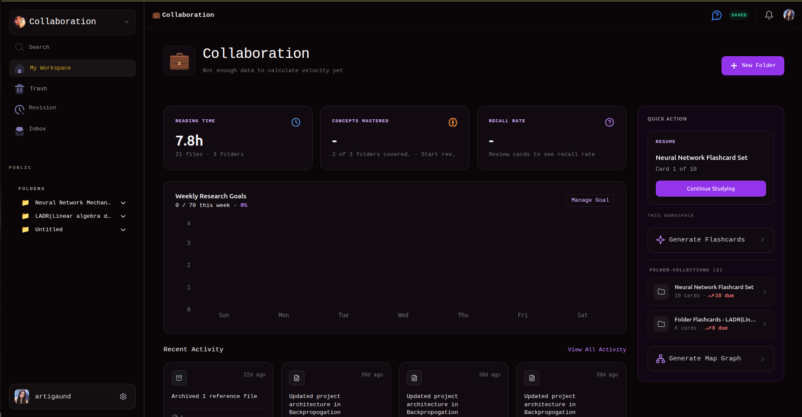

**Concept Graph** — auto-generated map of related terms across a folder's files, expandable into a full "Folder Intelligence" view with a Concept Map / Learning Path toggle
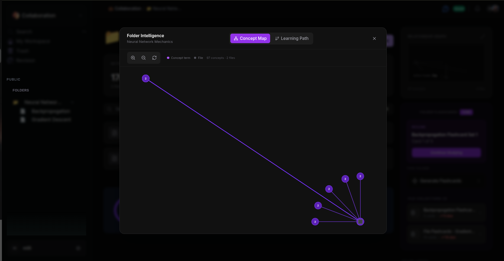

**Folder View** — per-folder analytics (active reading, mastery, recall rate), a folder-level relationship graph, and folder-wide flashcard sets
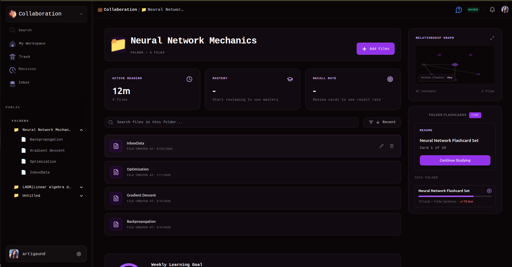

**File Editor** — block-based writing surface with live flashcard progress, file statistics, locked prerequisites, and related concept tags in the side panel
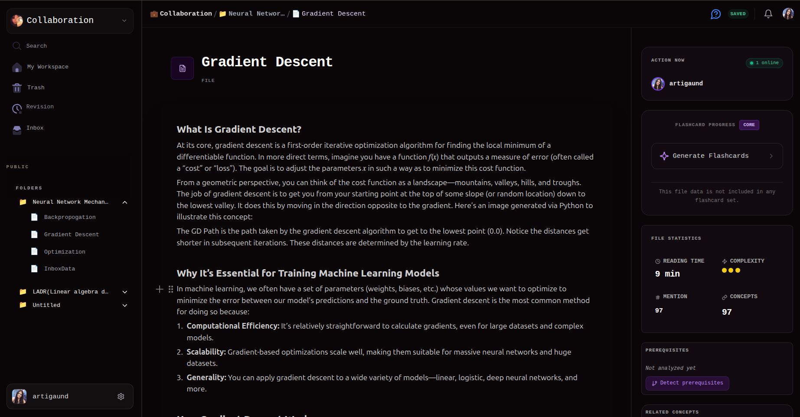

**Real-Time Collaborative Editing** — two users in the same file at once; typed content and slash-command menus sync instantly between sessions via Yjs + Socket.io
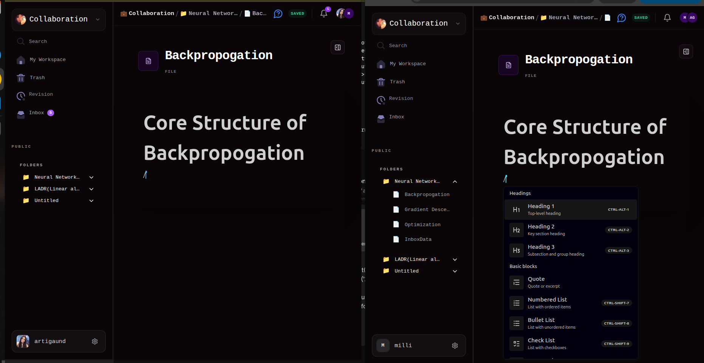

**Browser Clipper** — right-click any selection on the web, pick a content type, and save it straight into your Inbox — no tab-switching
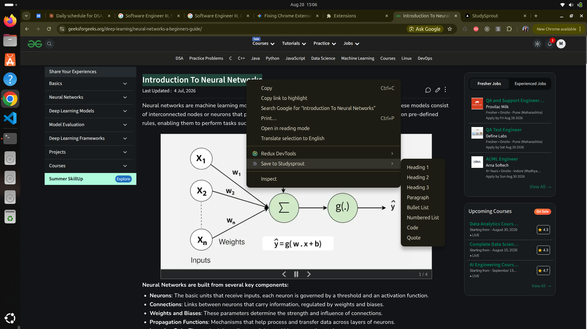

**Inbox** — captured content waiting to be filed, with per-item merge/delete and bulk select/merge/delete actions
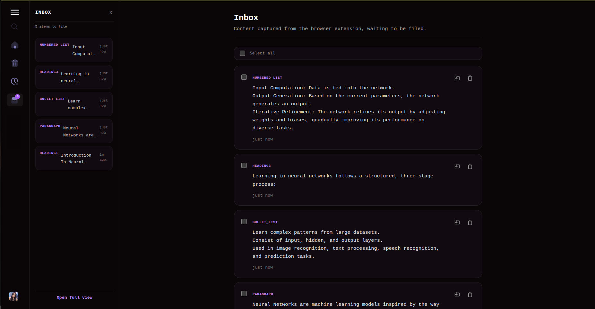

**Workspace Access & Roles** — invite collaborators by email, assign Owner/Editor roles, and manage who has access to a shared workspace
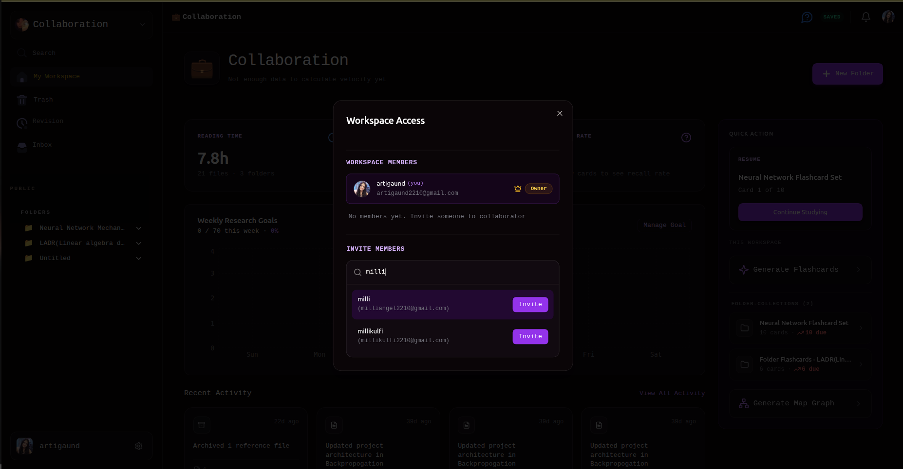

**Customizable Flashcard Generation** — choose the source (file or whole folder), card count, and question format (Q&A, Cloze, MCQ, Concept Diagram, Chart-based, Image Labeling)
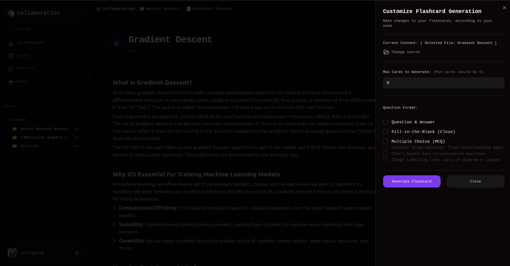

**Flashcard Review** — spaced-repetition study session with New / Due / Done tracking and a reveal-to-rate flow
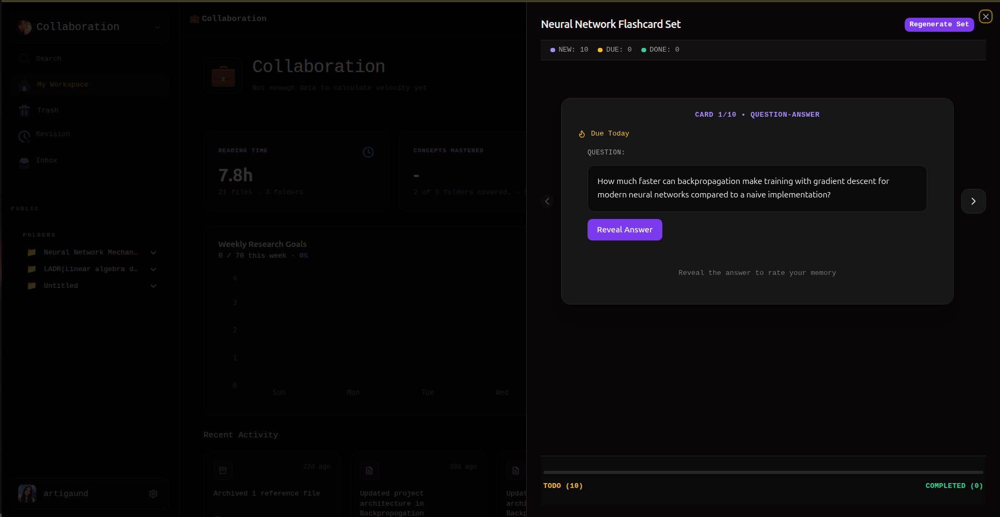

**Global Search** — search across workspace names, folders, and file content simultaneously, with matches highlighted inline
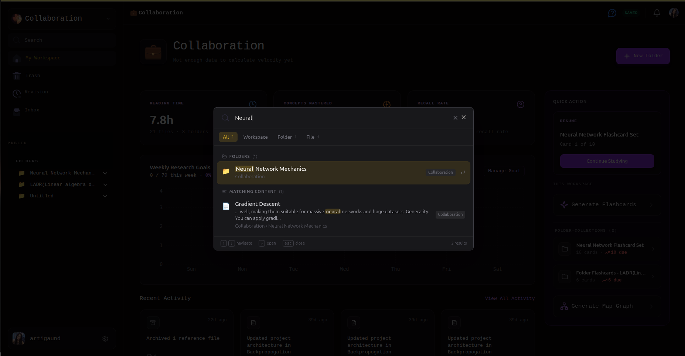

**Activity Log** — a running history of every meaningful action in a workspace (files created, flashcards generated, concept graphs synthesized)
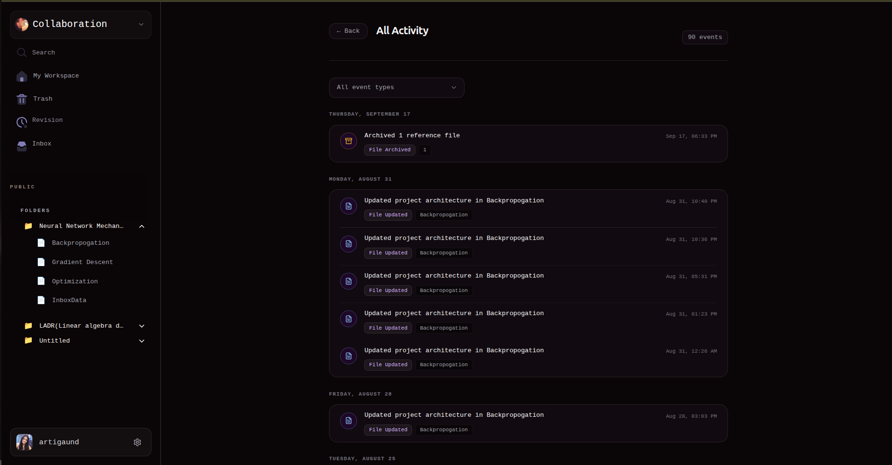

---

## Tech Stack

**Frontend**
- Next.js 14 (App Router), React 18, TypeScript
- Tailwind CSS, Radix UI
- BlockNote (rich text editor)
- Redux Toolkit (client state), Recharts (analytics charts)
- Custom SVG graph components (concept, prerequisite, relationship)
- Yjs + `socket.io-client` (collaboration)

**Backend**
- Next.js API routes (Node.js runtime), NextAuth
- MongoDB + Mongoose
- Redis + BullMQ: three queues, `pdf-processing`, `file-sync-queue`, `term-index-rebuild`
- [`studysprout-realtime-server`](https://github.com/ArtiGaund/studysprout-realtime-server): Express + Socket.io + Yjs, a standalone always-on server (serverless can't hold WebSocket connections)
- [`rate-limiter`](https://github.com/ArtiGaund/rate-limiter): Java 21 using the JDK's built-in HTTP server, Jedis, and an atomic Redis Lua token bucket
- Email: Resend / Brevo SMTP
- [`studysprout-clipper`](https://github.com/ArtiGaund/studysprout-clipper): Manifest V3, vanilla JS, rides the same NextAuth session cookie

**AI / Intelligence Layer**
- Google Gemini API: flashcard generation, folder concept synthesis
- Custom Python PDF pipeline (`pdfplumber`, `pikepdf`, `PyMuPDF`, `pillow`, poppler)
- Custom term extraction (stop-word filtering, tokenization, markdown/noise stripping)
- Custom prerequisite detection (whole-word term matching against a workspace term index, no LLM call)

**Infrastructure**
- Vercel: Next.js app (pages and API routes)
- Render: background workers (this repo, Docker), the realtime server, and the rate limiter
- MongoDB Atlas, Redis (shared by the app, workers, and realtime server), Cloudinary (PDF and image storage)

---

## Architecture

### Deployment topology — three services, two repos

```
┌──────────────────────┐         ┌──────────────────────────────┐
│   Vercel             │         │   Render                     │
│   Next.js App        │  ◄──────┤   studysprout-realtime-server│
│   (this repo)        │  HTTP   │   (separate repo)            │
│   Pages + API routes |───────► │   Socket.io + Yjs            │
└──────────┬───────────┘/emit/*  └───────────────┬──────────────┘
           │          ▲                          │
           │          │ POST /api/inbox          │
           │          │ (credentials: include)   │
           │   ┌──────┴───────────────┐          │
           │   │  Chrome Extension    │          │
           │   │  studysprout-clipper │          │
           │   │  (separate repo)     │          │
           │   └───────────────────────┘         │
           │                                     │
           │ enqueue jobs               enqueue  │ persist-file jobs
           ▼                                     ▼
    ┌───────────────────────────────────────────────────┐
    │              Shared Redis (BullMQ)                │
    └───────────────────────┬───────────────────────────┘
                            │ consumed by
                            ▼
              ┌─────────────────────────────────┐
              │   Render (Docker)               │
              │   studysprout background workers│
              │   (this repo, different start   │
              │    command via nixpacks.toml)   │
              │   PDF processing · file sync ·  │
              │   term index rebuilds           │
              └───────────────┬─────────────────┘
                              │
                              ▼
                    ┌──────────────────┐
                    │  MongoDB Atlas   │
                    └──────────────────┘

                    ┌──────────────────────────────┐
                    │ Render                       │
                    │ rate-limiter (Java)          │◄──── checked by flashcard-generation
                    │ (separate repo)              │ route before calling Gemini
                    └──────────────────────────────┘
```

**Why this split:** the Next.js app is request/response and serverless, which suits pages and API routes but can't host long-running processes. The BullMQ consumers (and the Python PDF subprocess) and the Socket.io server must stay alive continuously, so they run on Render. The worker service is the *same* codebase as the Vercel app, built with the repo's `Dockerfile` and started with a different command (`npm run worker:start`). The rate limiter is a fully standalone Java service called synchronously by the flashcard routes. The Clipper extension runs client-side in the browser and talks to the app's API routes directly.

**How the pieces talk to each other:**
-  Vercel API routes enqueue jobs directly into shared Redis
- The realtime server debounces live Yjs edits (2s) and pushes `persist-file` jobs to the same queue
- Workers poll the queues, process jobs, and write to MongoDB
- After processing, workers call the realtime server's `/emit/*` endpoints so connected browsers update instantly. API routes use the same endpoints for things like workspace invitations
- The realtime server calls back into the app's internal API (authenticated with a shared secret) to verify workspace membership
- The Chrome extension calls `/api/inbox` with the browser's session cookie; merging an Inbox item goes through the same Yjs pipeline as any other edit
- Before generating flashcards, the route checks the rate limiter and only proceeds to Gemini if allowed
- Nothing calls the worker directly; it has no public URL and receives work through the Redis queue

### PDF Processing Pipeline

```
Upload PDF → Cloudinary
   → BullMQ job enqueued
   → Python structural parser (headings, tables, math, images)
   → Page-based chunking into multiple topic files
   → Convert each chunk to a BlockNote (Yjs) document
   → Extract terms per file → mark workspace term index stale
   → Background worker rebuilds term index (debounced, every 30s)
   → Concept graph + prerequisite detection run in parallel
     (Promise.allSettled — one failing doesn't block the other)
   → Real-time socket events notify the UI as each file completes
```

### Real-Time Collaboration Layer

The editor is not single-player. Any file can have multiple people editing it concurrently:

```
User A types → Yjs local update → Socket.io broadcast → User B's Yjs doc merges the update
                                                      → User B's editor re-renders (no conflict)
```

- **Yjs** resolves conflicts (CRDT). There's no "last write wins": both users' edits are preserved and merged deterministically
- **Socket.io** is the transport, handled by [`studysprout-realtime-server`](https://github.com/ArtiGaund/studysprout-realtime-server). See that repo for the socket-event breakdown, presence architecture, and generation-lock implementation
- Presence is tracked separately from document content, so "online" indicators update even when nobody is typing
- Discrete actions (rename, generate) can't be merged like text, so they use locks. See [Real Concurrency Control](#-real-concurrency-control)

### Term Index & Concept Graph

The system maintains a workspace-wide `termIndex`: a map of `term → [fileIds that contain it]`. This one structure powers three features:
 
1. **Concept graphs**: terms in 2+ files become graph nodes
2. **Prerequisite detection**: if file B contains a term that's "defined" (indexed) in file A, A becomes a prerequisite candidate for B
3. **Folder/workspace relationship graphs**: aggregating shared terms (or file-level prerequisite edges) up to the folder level yields subject-to-subject relationships
Rebuilds are debounced: file saves just flip a `termIndexStale` flag, and a repeatable BullMQ job checks every 30 seconds for stale workspaces, so rapid edits collapse into one rebuild instead of one per keystroke.

---

## Notable Technical Decisions

**Why chunk PDFs into multiple files?**
A 100-page PDF as one file is unstudyable. Page-based chunking gives digestible study units and lets the concept and prerequisite systems work at a useful granularity (file to file).
 
**Why term matching instead of an LLM call for prerequisites?**
Cost and speed. Checking every file against every other file's terms with an LLM is slow and expensive. A term-index lookup is instant, and it's good enough in practice, with a manual override to fix the misses. *(Add a measured accuracy figure here once you've hand-labeled a few folders; "70–80%" isn't backed by a measurement yet.)*
 
**Why Yjs for text but locks for rename and generation?**
Text edits can merge, so CRDTs avoid one person blocking everyone else. Renames and AI generation are discrete actions that can't merge, so they use deliberate locks with hierarchical checks and a crash-safety timeout.
 
**Why a separate realtime server?**
Vercel can't hold WebSocket connections open. A separate service on Render gives always-on real-time behavior without moving the whole app off Vercel.
 
**Why a standalone Java service for rate limiting?**
It keeps abuse prevention out of route handlers and lets the algorithm (token bucket, atomic via a Redis Lua script) be built and tested in isolation. It's reusable by any future route, and it fails open on purpose so a limiter outage never blocks users.
 
**Why one `emitServerRealtimeEvent` convention?**
Early on, sockets double-emitted events from several code paths. Standardizing on one emit helper and auditing every call site fixed a class of bugs where the UI flickered or applied the same update twice.
 
**Why a private, global Inbox?**
Capture happens outside any workspace; you're reading an article, not sitting in StudySprout. Choosing *where* something belongs is a separate, more deliberate decision, so capture stays frictionless and filing stays intentional.
 
**Why does the Clipper's merge go through the Yjs pipeline?**
An early version wrote merged content straight to MongoDB. It either overwrote existing content or got clobbered by the next live autosave, because it never touched the in-memory Yjs document the realtime server treats as the source of truth. Routing merges through the live pipeline makes them broadcast instantly, persist through the normal worker, and stay safe under concurrent merges.

---

## Project Structure

```
studysprout/
├── src/
│   ├── app/
│   │   ├── api/                      # auth, file, folder, workspace, flashcard, flashcard-set,
│   │   │                             # flashcard-review/-progress, inbox, notifications, pdf,
│   │   │                             # search, internal, health, ...
│   │   ├── (app)/dashboard/          # main authenticated app
│   │   └── (auth)/                   # sign in / sign up / verify / reset
│   ├── components/
│   │   ├── editor/                   # BlockNote wrapper, presence
│   │   ├── dashboard-shared/         # concept graph, relationship graph, flashcard section
│   │   ├── flashcard/ revision/      # study viewer, generation sidebar
│   │   ├── inbox/ trash/ global-search/ notifications/ ...
│   │   └── ui/
│   ├── lib/
│   │   ├── workers/                  # syncWorker, pdfWorker, workspace-term-index, index.ts
│   │   ├── bullmq/                   # queue + redis connection
│   │   ├── flashcard/                # generation + usage-cap logic
│   │   └── socket/                   # client-side socket events
│   ├── model/                        # Mongoose schemas
│   ├── services/                     # business logic reused by API routes + workers
│   └── utils/                        # pdf parser/chunker, term extraction, prerequisites, SRS
├── scripts/                          # pdf_extractor.py, one-off migration scripts
├── requirements.txt                  # Python dependencies for the PDF parser
├── Dockerfile                        # worker service image (Render)
└── public/                           # service worker, offline page
```

> The browser extension that feeds the Inbox (`/api/inbox`) lives in a separate repo — see [`studysprout-clipper`](https://github.com/ArtiGaund/studysprout-clipper).

---

## Getting Started

### Prerequisites
- Node.js 20+
- MongoDB
- Redis 7+
- Python 3.9+ and poppler (PDF parsing)

### Environment Variables

```bash
# Database & queues
MONGO_URL=mongodb://localhost:27017/studysprout
REDIS_URL=redis://localhost:6379
 
# Auth
NEXTAUTH_SECRET=your_secret
NEXTAUTH_URL=http://localhost:3000
GOOGLE_ID=...
GOOGLE_SECRET=...
GITHUB_ID=...
GITHUB_SECRET=...
 
# AI & storage
GEMINI_API_KEY=your_gemini_key
CLOUDINARY_CLOUD_NAME=...
CLOUDINARY_API_KEY=...
CLOUDINARY_API_SECRET=...
 
# Email
RESEND_API_KEY=...
BREVO_SMTP_USER=...
BREVO_SMTP_PASS=...
 
# Services
NEXT_PUBLIC_APP_URL=http://localhost:3000
NEXT_PUBLIC_REALTIME_URL=http://localhost:4000
REALTIME_SERVER_URL=http://localhost:4000
RATE_LIMITER_URL=your_rate_limiter_url
MAIN_API_URL=http://localhost:3000
INTERNAL_SECRET=shared_secret_between_app_and_realtime_server
 
# Optional
NEXT_PUBLIC_EXTENSION_ID=...
OWNER_EMAIL=...
FLASHCARD_USE_MOCK=false
```

### Setup

```bash
git clone https://github.com/ArtiGaund/studysprout.git
cd studysprout
 
npm install
pip install -r requirements.txt
 
# Terminal 1: Next.js app
npm run dev
 
# Terminal 2: background workers (PDF, term index, file sync)
npm run dev:worker
```

Clone [`studysprout-realtime-server`](https://github.com/ArtiGaund/studysprout-realtime-server) next to this repo (`../studysprout-realtime-server`) and run it for live collaboration, presence, and generation locks. Or run everything in one terminal:
 
```bash
npm run dev:all
```
 
To test the Clipper extension locally, see [`studysprout-clipper`](https://github.com/ArtiGaund/studysprout-clipper). It needs this app running at `http://localhost:3000`.

### Deployment
- **Next.js app**: Vercel
- **Background workers**: Render, built from this repo's `Dockerfile` and started with `npm run worker:start`
- **Realtime server**: Render, from the separate [`studysprout-realtime-server`](https://github.com/ArtiGaund/studysprout-realtime-server) repo
- **Rate limiter**: Render, from the separate [`rate-limiter`](https://github.com/ArtiGaund/rate-limiter) repo
- **Clipper extension**: published on the Chrome Web Store

---

## Current Status & Roadmap

**Shipped**
- PDF upload → structured multi-file extraction
- Folder and workspace concept graphs
- Automatic and manual prerequisite detection
- Flashcards (file and folder level) with spaced repetition; Q&A, Cloze, MCQ, and True/False formats
- Reading time, mastery, and recall analytics
- Real-time collaborative editor with title-editing and generation locks
- Workspace invitations, roles, notifications, trash/restore
- Java rate limiting on Gemini calls
- Browser Clipper (Chrome Web Store) and private Inbox with bulk actions and Yjs-backed merge
- Production deployment on Vercel and Render
**In progress**
- [ ] Automated tests and CI (unit tests for SM-2, the monthly cap, prerequisite detection, and the token bucket; lint/type-check/build on every push)
- [ ] More flashcard formats: Concept Diagram, Chart-based, Image Labeling (the chart card type and renderer exist; generation is unfinished)
**Planned**
- [ ] Research-paper reading mode (section-aware summaries, plain-language explanations, cited Q&A)
- [ ] Retrieval-augmented Q&A across a workspace, then a graph-guided version
- [ ] Full offline mode (service worker + local sync)
 
---

## What I Learned Building This

- Designing a background-job system (BullMQ) so expensive work (PDF parsing, concept graph builds, term index rebuilds) never blocks the request cycle and fails independently
- Debugging CRDT collaborative editing, including an echo-back bug where the editor's hydration effect re-broadcast a client's full document state as a live incremental update, corrupting merged documents for other clients until I traced it to one redundant `socket.emit`
- Building real concurrency control: discrete-action locking (title edits, generation) with hierarchical checks and crash-safety timeouts
- Enforcing usage limits safely under concurrency, using an atomic `findOneAndUpdate` with `$expr` instead of a racy read-then-write
- Splitting one product across Vercel and Render by which parts must run continuously, and keeping Redis, Mongo, and env vars consistent across independently deployed services
- The cost/accuracy tradeoff between LLM and heuristic extraction (term matching for prerequisites, Gemini for flashcards)
- Auditing a real-time system for duplicate event emissions and parameter mismatches that desynced UI state
- Building a standalone token-bucket rate limiter (atomic via a Redis Lua script, verified against concurrent requests) and choosing fail-open behavior on purpose
- Designing an Inbox that is deliberately not workspace-scoped, and what that means for the data model
- Bridging auth between a website and a browser extension without a second login system

---

## Related Repositories

- **This repo** — Next.js app, API routes, background workers, PDF pipeline, concept graph, flashcards
- **[`studysprout-realtime-server`](https://github.com/ArtiGaund/studysprout-realtime-server)** — Socket.io + Yjs collaboration server, presence tracking, generation/title locks
- **[`rate-limiter`](https://github.com/ArtiGaund/rate-limiter)** — standalone Java service for rate-limiting Gemini API calls
- **[`studysprout-clipper`](https://github.com/ArtiGaund/studysprout-clipper)** — Chrome extension (Manifest V3) that captures web content into the Inbox

## Contact

**Arti Gaund**
[LinkedIn](https://linkedin.com/in/artigaund) · [Email](mailto:artigaund2210@gmail.com) · [GitHub](https://github.com/ArtiGaund)

---

Built solo, end to end — parsing pipeline, real-time backend, deployment architecture, analytics, and UI.

## License
This project is not open source. The code is publicly viewable for portfolio 
purposes, but all rights are reserved — please do not copy, reuse, or 
redistribute without permission.
